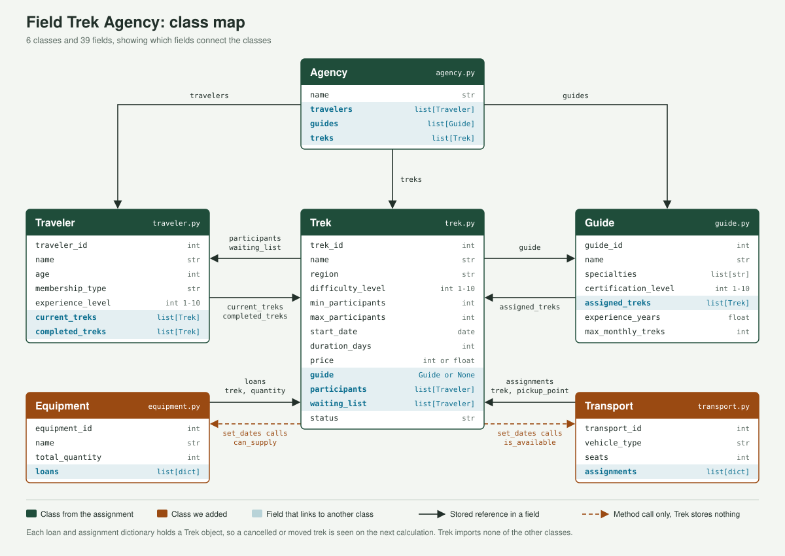

# Field Trek Agency

A Python object-oriented simulation of an agency that runs field treks. It manages treks, travelers, guides, registrations, waiting lists, cancellation refunds and season schedules, and it adds equipment and transport as an extension.

This is coursework for the Simulation course. The final submission is a Colab notebook, and this repository holds the classes it will be built from.

## Status

| Part | State |
| --- | --- |
| `Trek`, `Traveler`, `Guide`, `Agency` | Written |
| `Equipment`, `Transport` (extension) | Written |
| `tests.py` | Empty, the demonstrations are still to be written |
| Colab notebook | Not started |

The classes were checked with scripts kept outside this repository, so nothing here runs automatically yet.

## Project layout

```text
task_1_314953852/
  trek.py        Trek: dates, capacity, registration, refunds, status
  traveler.py    Traveler: registrations, private tours, payment report
  guide.py       Guide: assigned treks, availability, statistics
  agency.py      Agency: repositories, search, reports
  equipment.py   Equipment: stock lent to treks by date
  transport.py   Transport: vehicles assigned to treks
  tests.py       Empty placeholder
docs/
  trek_protocol_pages.html   Work protocol, in Hebrew
.claude/skills/course-oop/   OOP rules used while writing the code
```

## Quick start

The code uses only the Python standard library. Run it from inside `task_1_314953852`, because the modules import each other by name.

```python
from datetime import date, timedelta
from trek import Trek
from traveler import Traveler
from guide import Guide
from agency import Agency
from equipment import Equipment
from transport import Transport

start = date.today() + timedelta(days=45)

agency = Agency("Field Treks")
guide = Guide(1, "Noa", ["Negev"], 7, 4.5, 3)
traveler = Traveler(1, "Dana", 30, "annual", 6)
trek = Trek(1, "Ramon Crater", "Negev", 5, 1, 12, start, 3, 1000)

agency.add_guide(guide)
agency.add_traveler(traveler)
guide.assign_trek(trek)
agency.add_trek(trek)
traveler.register_to_trek(trek)

tents = Equipment(1, "Tent", 20)
tents.loan_to_trek(trek, 6)
bus = Transport(1, "Minibus", 13)
bus.assign_to_trek(trek, "Beer Sheva")

print(trek.status)                               # confirmed
print(traveler.get_final_price(trek))            # 900.0
print(Transport.has_enough_seats(trek, [bus]))   # True
print(agency.search_treks("negev")[0].name)      # Ramon Crater

# Pass the trek's vehicles and equipment so a move is checked against them
trek.set_dates(start + timedelta(days=7), 3, [bus], [tents])
```

Invalid input and broken rules raise `ValueError` before anything changes, so calling code handles them with `try/except`.

## Classes

| Class | Fields | Responsibility |
| --- | --- | --- |
| `Trek` | 13 | Validates dates and capacity, registers travelers, runs the waiting list, calculates refunds and holds the status |
| `Traveler` | 7 | Holds current and completed treks, requests private tours and produces a payment report |
| `Guide` | 7 | Holds assigned treks, checks availability and produces statistics |
| `Agency` | 4 | Holds the repositories, searches treks and produces the season and membership reports |
| `Equipment` | 4 | Tracks a stock item lent to treks, by day |
| `Transport` | 4 | Tracks a vehicle assigned to treks, with a pickup point for each trek |

### How the classes connect



- `Agency` holds lists of travelers, guides and treks.
- `Trek` and `Traveler` point to each other, and so do `Trek` and `Guide`. One method makes each change and updates both sides.
- `Equipment` and `Transport` point to `Trek`, and `Trek` has no field pointing back.
- `Trek` imports none of the other classes. It recognizes them by their shared field names, which avoids circular imports.

## Design rules

- The classes from the assignment keep only the fields it lists. Methods and optional parameters can be added, and new fields appear only in the new classes.
- Attributes are public, following the course tutorial, so the rules are enforced by the constructor and the methods. Calling code should read fields and change them only through methods.
- Methods that change state validate first and update last, so a failure leaves nothing half done.
- Reports are calculated on every call and are never stored.
- Date overlap is calculated in one place, `Trek.overlaps`. The end day counts, so a one day trek ends on its start date.

## Assumptions

The assignment leaves these open, and they can be changed.

| Topic | Choice |
| --- | --- |
| Refund by days before departure | 30 or more: 100%. 14 to 29: 75%. 7 to 13: 50%. Fewer: 0% |
| Membership discount | Basic 0%, annual 10%, premium 20% |
| Waiting list order | Premium, then annual, then basic, and by arrival within each type |
| Scales | Difficulty, experience and certification all run from 1 to 10 |
| Guide's monthly limit | Counted by departure month |
| Private tour | Costs 500 per day, in the guide's first specialty, at the traveler's experience level |
| Seasons | By departure month: winter December to February, spring March to May, summer June to August, autumn September to November |
| Schedule warnings | Active treks that share a day in the same region |
| Vehicle seats | The vehicles of a trek must seat `max_participants` plus the guide |

## Known limitations

- `Trek` has no field for vehicles or equipment, so `set_dates` checks only the ones passed to it. Anything left out is not checked, and its `find_conflicts` method reports the clash after the move.
- `Agency` has no field for vehicles or equipment, so the calling code keeps those objects and their ids unique.
- `Agency.add_trek` checks the trek's guide only when the trek is added. A guide assigned later is not checked against the repository.
- A private tour appears in the agency's reports only after `add_trek` is called for it.
